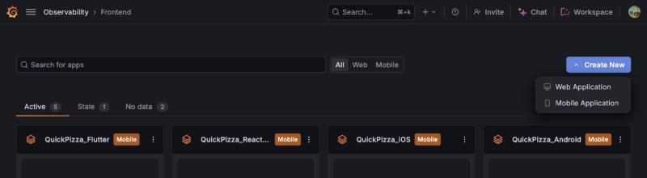
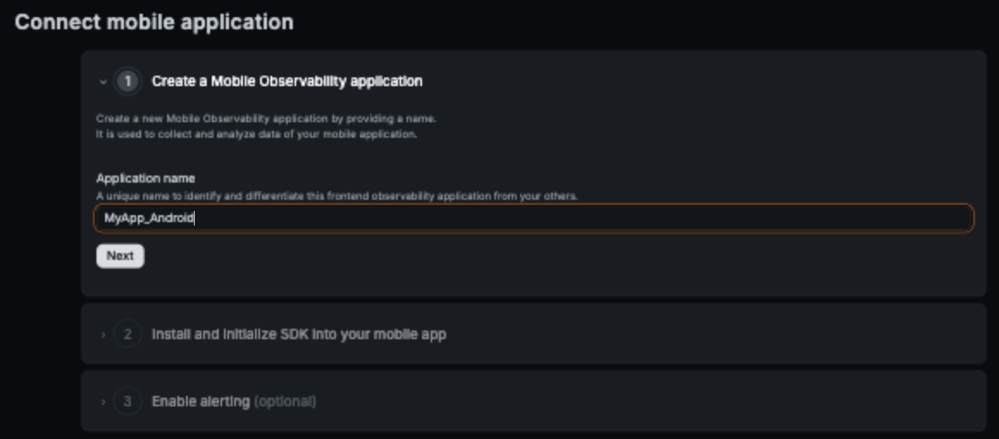
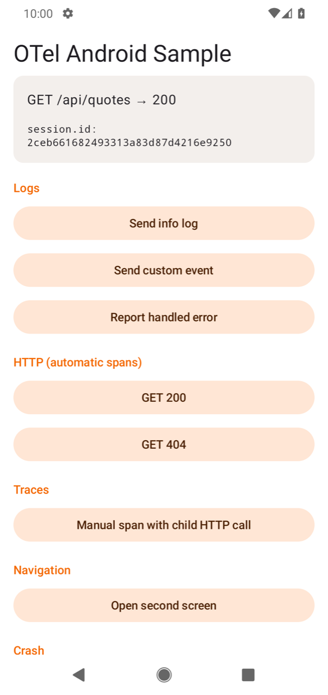
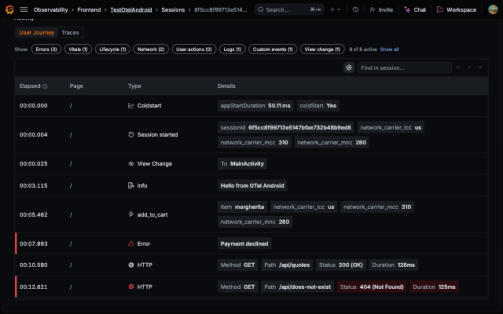

# OpenTelemetry Android → Grafana Frontend Observability (Android)

A tiny Jetpack Compose app that sends logs, events, errors, crashes, screen views, manual spans and
HTTP spans to Grafana Frontend Observability, using **plain OpenTelemetry Android**, with no Grafana
SDK.

All the OpenTelemetry code is in one file:
[`OTel.kt`](app/src/main/java/com/example/otelandroidsample/OTel.kt). Copy it into your own app and
follow the steps below. Your build needs AGP 9.1+, `compileSdk` 37 and Kotlin 2.3+
([requirements](#1-add-the-dependencies)).

> **Status:** private preview. Tested with `opentelemetry-android` 1.8.0 (BOM `1.8.0-alpha`),
> OkHttp 5.5, Android Studio 2026.2, Pixel 4 emulator (Android 11, API 30), against a production
> Grafana Cloud stack.

## Run the sample (5 minutes)

You need Android Studio (or JDK 17+ and the Android SDK for command-line builds).

1. **Create the app in Grafana.** In Frontend Observability, click **Create New → Mobile Application**.

   

   Give it a name and click **Next**.

   

2. **Copy the OTLP endpoint.** Open the app, go to **Settings → Mobile SDK Config**, and pick
   **Android**. Under **3. Initialize Android Agent**, copy the `baseUrl` value. It already has the
   right format, with `/otlp/` and your app key:

   ```text
   https://faro-collector-<region>.grafana.net/otlp/<app-key>
   ```

   Use this URL, not the `/collect/` URL used by the Faro SDKs.

3. **Paste it** into `OTelConfig.OTLP_ENDPOINT` in
   [`OTel.kt`](app/src/main/java/com/example/otelandroidsample/OTel.kt).
4. **Open** this folder (`Mobiles/quickstart/android`) in Android Studio, pick an emulator, press
   **Run**. Or, with an emulator running, run `./gradlew installDebug` and open the app.
5. **Tap every button** in the app. Tap **Crash the app** last, then open the app again: the crash
   is sent on the next launch.

   
6. **Open your app in Frontend Observability.** Sessions, logs, errors, crashes and HTTP requests
   appear about 45 seconds later (see [Disk buffering](#disk-buffering)). The
   session ID on screen matches the one in Grafana. Open it under **Sessions** to see its journey:

   

## Add it to your own app

### 1. Add the dependencies

Your build needs (the agent's dependencies set these floors):

- **Android Gradle Plugin 9.1 or newer (tested with 9.5) and `compileSdk` 37.** The agent pulls in
  `androidx.core` 1.19 and OkHttp 5.5, which refuse to build with anything older.
- **Kotlin 2.3 or newer.** The agent is built with Kotlin 2.4, which Kotlin 2.3 compilers can still
  read; 2.2 and older fail with "Module was compiled with an incompatible version of Kotlin". Compose apps on the Compose compiler plugin 2.3+
  already have it. Without Compose, AGP 9's built-in Kotlin (2.2) is too old. AGP uses the Kotlin
  Gradle plugin found on the build classpath, so add this to the root `build.gradle.kts` (any 2.3+
  version works):

  ```kotlin
  plugins {
      id("org.jetbrains.kotlin.android") version "2.4.21" apply false   // sets the Kotlin version
  }
  ```

  Only in the root, with `apply false`: AGP 9 refuses the plugin in the app module.

- **`minSdk` 23 or newer**, or 24 if you use Navigation Compose (androidx.navigation requires it).

In `app/build.gradle.kts` (if `compileOptions` already exists, add the line to it):

```kotlin
android {
    compileOptions {
        isCoreLibraryDesugaringEnabled = true   // required, see below
    }
}

dependencies {
    coreLibraryDesugaring("com.android.tools:desugar_jdk_libs:2.1.5")

    implementation(platform("io.opentelemetry.android:opentelemetry-android-bom:1.8.0-alpha"))
    implementation("io.opentelemetry.android:android-agent")
    // HTTP spans for OkHttp. Leave out if your app does not use OkHttp. Your app must also declare
    // OkHttp itself (for example "com.squareup.okhttp3:okhttp:5.5.1"), as most OkHttp apps already do.
    implementation("io.opentelemetry.instrumentation:opentelemetry-okhttp-3.0")
    // Screen views for Jetpack Compose navigation. Leave out if your app does not use it.
    implementation("io.opentelemetry.android.instrumentation:compose-navigation")
}
```

The BOM keeps every OpenTelemetry artifact on matching versions, so the lines below it need no
version.

The agent ships OkHttp 5 for its own exporter, so if your app uses OkHttp, it ends up on OkHttp 5
(Retrofit 2.11 works with it). Your app does not use OkHttp, directly or through Retrofit? Leave
out the `opentelemetry-okhttp-3.0` line, delete `httpClient`, `traced` and `UrlWithoutQuery` and
their imports from `OTel.kt`, and skip the HTTP examples in step 4.

`android-agent` brings sessions, the OTLP/HTTP exporter, crash and ANR reporting, app start,
Activity and Fragment screen views, and slow-render detection.

**Turn on core library desugaring** if your `minSdk` is below 31, which is almost every app. The
agent calls `java.time` methods that Android only has natively from Android 12 (API 31). Without
desugaring the app still builds, but on Android 11 and older it **crashes when it goes to the
background**, and slow-frame reporting stops (upstream bug
[opentelemetry-android#2183](https://github.com/open-telemetry/opentelemetry-android/issues/2183)).
Desugaring also needs this line in `gradle.properties`:

```properties
android.useFullClasspathForDexingTransform=true
```

### 2. Copy `OTel.kt` and set two values

Copy [`OTel.kt`](app/src/main/java/com/example/otelandroidsample/OTel.kt) into your app and change
its first line to your package. Then edit the two values in `object OTelConfig` at the top:

```kotlin
const val OTLP_ENDPOINT = "https://faro-collector-<region>.grafana.net/otlp/<app-key>"
const val ENVIRONMENT = "development"
```

- `OTLP_ENDPOINT`: your app's OTLP URL, found as in [Run the sample](#run-the-sample-5-minutes),
  step 2. No API token is needed; the app key in the path is the credential.
- `ENVIRONMENT`: for example `development`, `staging` or `production`. Keeps them apart in Grafana.

The app version comes from your `versionName` automatically.

### 3. Start it from your `Application`

Already have an `Application` class? Add `OTel.start(this)` as the first line after
`super.onCreate()`. Otherwise create one:

```kotlin
class MyApp : Application() {
    override fun onCreate() {
        super.onCreate()
        OTel.start(this)   // first thing
    }
}
```

Register it in `AndroidManifest.xml`, and make sure the app has these permissions:

```xml
<manifest xmlns:android="http://schemas.android.com/apk/res/android">
    <uses-permission android:name="android.permission.INTERNET" />
    <!-- Optional: adds the network type (wifi, cell) to telemetry. -->
    <uses-permission android:name="android.permission.ACCESS_NETWORK_STATE" />

    <application android:name=".MyApp" …>
```

### 4. Send your own telemetry

`OTel.kt` has small helpers for the common cases. See
[`MainActivity.kt`](app/src/main/java/com/example/otelandroidsample/MainActivity.kt).

```kotlin
import io.opentelemetry.api.common.AttributeKey.stringKey
import io.opentelemetry.api.common.Attributes
import io.opentelemetry.api.logs.Severity

// Log
OTel.log("Checkout started")
OTel.log("Cart is empty", Severity.WARN, Attributes.of(stringKey("screen"), "cart"))

// Event
OTel.event("add_to_cart", Attributes.of(stringKey("item"), "margherita"))

// Handled error (crashes are reported automatically). pay() stands for your own code.
try { pay() } catch (e: Exception) { OTel.logException(e) }

// The current session ID, for example to show on a debug screen. Null if OTel is not started.
val sessionId: String? = OTel.sessionId
```

Logs, events, errors and spans are cheap, so call them from any thread, including the main thread.

A manual span. OkHttp calls made inside the block become its child spans. Network calls must
leave the main thread, so this one runs on a background dispatcher (`kotlinx-coroutines-android`,
which Compose apps already have; any background thread works too):

```kotlin
import kotlinx.coroutines.Dispatchers
import kotlinx.coroutines.launch
import okhttp3.Request

scope.launch(Dispatchers.IO) {   // for example rememberCoroutineScope() or viewModelScope
    OTel.span("load_cart") {
        val request = Request.Builder().url("https://api.example.com/cart").build()
        OTel.httpClient.newCall(request).execute().use { /* read the response */ }
    }
}
```

`OTel.span` makes the span current on the calling thread only, so keep the block synchronous, as
above. Calls made from a coroutine launched inside the block do not get it as parent; for that, see
`asContextElement()` in `opentelemetry-extension-kotlin`.

The helpers are a few lines each, on top of the standard OpenTelemetry API. Use `OTel.logger`,
`OTel.tracer` or `OTel.openTelemetry` directly when you need more control.

**Screen views.** Activities and Fragments are tracked automatically, named after their class
(`MainActivity`) or an `@RumScreenName` annotation. For Jetpack Compose navigation, add one line
right after you create the `NavController`, in the same composable:

```kotlin
import io.opentelemetry.instrumentation.compose.navigation.withOpenTelemetry

val navController = rememberNavController()
OTel.rum?.let { navController.withOpenTelemetry(it) }   // rum is null if OTel did not start
```

It registers once per `NavController`, so recomposition does not add duplicates. Using several
`NavController`s, for example one per tab? Add the line for each. Every route
change, including the start route and going back, then shows up as a screen view named after the
route (`home`, `details`). A route with arguments shows its pattern, for example `details/{id}`;
pass `screenName = { destination, args -> ... }` to `withOpenTelemetry` to name it differently.
The sample's **Open second screen** button shows it.

**HTTP requests** are traced when they go through `OTel.httpClient`. To trace your own client,
wrap it once with `OTel.traced` and use the result wherever you used the client (Retrofit takes it
as `callFactory`):

```kotlin
val callFactory: okhttp3.Call.Factory = OTel.traced(myOkHttpClient)

Retrofit.Builder().callFactory(callFactory) // ...
```

The recorded URL keeps scheme, host and path only: `OTel.traced` drops the query string, fragment
and credentials, so tokens or personal data in a query never reach Grafana.

Every traced request gets a W3C `traceparent` header that links it to your backend traces.
`OTel.start()` must have run before you wrap the client, or the wrapper records nothing. So do not
wrap it in a static initializer or an eagerly created singleton; create it on first use (`by lazy`,
like `OTel.httpClient`) or from your dependency injection after `Application.onCreate()`.

To trace *every* OkHttp client, including ones built inside third-party libraries, use the
OpenTelemetry Android `okhttp3-agent` Byte Buddy plugin instead. It rewrites OkHttp at build time;
the Android tab of **Mobile SDK Config** shows that setup.

**Skip hosts you don't want traced**, for example a third-party SDK's API. Spans for these hosts
are dropped before export, for `OTel.httpClient` and clients you wrap yourself; the requests still
get a `traceparent` header. Add this inside the
`initialize { }` block in `OTel.kt` (the API is marked incubating, hence the opt-in):

```kotlin
import io.opentelemetry.android.Incubating

@OptIn(Incubating::class)
instrumentations {
    httpTelemetry {
        val ignored = listOf("analytics.example.com", "ads.example.net")   // matches subdomains too
        shouldRecordSpanForHost { host -> ignored.none { host == it || host.endsWith(".$it") } }
    }
}
```

## The rules that make data show up

If you change the setup, keep these. Most cause "I see no data"; the rest cause confusing or unwanted data.

| Rule | What happens if you skip it |
| --- | --- |
| Use the `/otlp/<app-key>` URL from Frontend Observability | Data sent to the Grafana Cloud OTLP gateway (`otlp-gateway-*`) lands in Loki/Tempo but **never** in Frontend Observability. A `/collect/` URL returns HTTP 404. |
| Set it as `httpExport.baseUrl`, without `/v1/traces` or `/v1/logs` | The agent appends the signal paths itself. (OTel Swift is the opposite: there you add them.) |
| Use `OpenTelemetryRumInitializer` (the agent) | It adds `session.id` to every span and log. Every record must carry it; one record without it and the **whole batch is rejected**, silently. A hand-built `OpenTelemetrySdk` has no sessions. |
| Keep sessions at 15 min background timeout and 4 h max | Other values break Grafana's session counts. They are the agent's defaults; `OTel.kt` spells them out. |
| Remove `service.name` from the resource | Data still arrives, but logs, events and errors show your app label (`android:label`), while traces show the registered app name. |
| Core library desugaring on | On Android 11 and older, the app crashes when it goes to the background (`NoSuchMethodError` in `SlowRenderListener`). |
| `disableMetrics()` | Metrics are accepted and silently dropped. Send an event instead. |
| `OTel.start()` right after `super.onCreate()` in your `Application` | Started later, it misses app start, the first screen, and crashes before that point. |
| Wrap OkHttp clients **after** `OTel.start()` | A client wrapped earlier uses the no-op API and records nothing. |
| Wrap them with `OTel.traced`, not `OkHttpTelemetry` directly | The instrumentation on its own records the full URL, including query parameters such as `?token=…`. |

### Disk buffering

Disk buffering is on by default, and worth keeping. Telemetry is written to disk first and sent
from there, so it reaches Grafana about 45 seconds after it happens. In return, telemetry recorded
offline is sent once the device is back online, and crashes are sent on the next launch.

## Troubleshooting

1. **Look at Logcat.** Export errors are logged with the tag `HttpExporter`, for example
   `Failed to export 2 logs. Server responded with HTTP status code 404`. Filter on
   `tag:HttpExporter | tag:OTel | tag:OpenTelemetryRum`. `OTel: Not started` means the endpoint is
   still the placeholder; `OTel: OpenTelemetry failed to start` comes with the reason. Because of [disk buffering](#disk-buffering), export errors appear about
   45 s after launch.
2. **Check the URL.** It must contain `/otlp/`, not `/collect/`, must be the URL of *this* app, and
   must not end in `/v1/traces` or `/v1/logs`.
3. **Query Loki directly.** In Grafana Explore, pick the `grafanacloud-…-logs` datasource and run:

   ```logql
   {app_id="<your app id>"}
   ```

   The app ID is the number in the Frontend Observability URL (`…/apps/<app id>`).
   Results here but not in the app view? Widen the time range and wait a minute.
   No results at all? Re-check the URL and that you start the agent, not a plain SDK.
4. **Wait for the buffer.** See [Disk buffering](#disk-buffering). To check your setup faster, turn it off
   temporarily inside `initialize { }`: `diskBuffering { enabled(false) }`. Signals then arrive
   within a few seconds, but are lost while the device is offline.
5. **No slow or frozen frames?** Check that core library desugaring is on (step 1 of
   [Add it to your own app](#add-it-to-your-own-app)). Only slow *drawing* counts: work in a click
   handler blocks the app but does not show up as a slow frame.
6. **`Missing read phone state permission` in Logcat?** Harmless: the agent still reports the
   network type. Do not add `READ_PHONE_STATE` just for this.

## What you get, and what you don't (yet)

| Works | Not available yet |
| --- | --- |
| Sessions (start, 15 min in background, 4 h max, new on each launch) | Deobfuscation: this sample uploads no R8 mapping file, so minified release builds show obfuscated stack traces |
| Logs, events, handled errors | Native (NDK) crashes (a separate `native-crash` instrumentation, not part of this sample) |
| Crashes (sent on the next launch) and ANRs (main thread blocked for about 10 s) | Metrics (dropped by design) |
| App start time | |
| Screen views per Activity and Fragment, and per Compose navigation route | |
| Slow and frozen frames | |
| HTTP spans for OkHttp, linked to your backend via `traceparent` | |
| Manual spans | |
| Device, OS, app version, network type, environment | |

**What screen views look like.** Each Activity and Fragment shows up as a screen view when it
appears, named after its class (`LoginActivity`, `ProfileFragment`). A Compose app shows one for its
Activity at launch (`MainActivity`), then one per navigation route (`home`, `details`), as described
in [Screen views](#4-send-your-own-telemetry). Returning to the app from the background does not
add a new screen view.

## Next steps for production

- **User identity.** To put `user.id` on every log and span, keep the current user in a variable and
  add a supplier inside `initialize { }` in `OTel.kt`. It is read for every record, so a user who
  logs in later is picked up (unlike `globalAttributes { }`, which is read once at startup).
  Records from before login have no `user.id`:

  ```kotlin
  // In object OTel. Set it after login, set it to null after logout.
  @Volatile var userId: String? = null

  // Inside initialize { }. Note the two pairs of braces: the block returns a function.
  globalAttributesSupplier {
      { userId?.let { Attributes.of(AttributeKey.stringKey("user.id"), it) } ?: Attributes.empty() }
  }
  ```
- **Release builds.** R8 obfuscates class and method names in stack traces. This sample does not
  upload mapping files.
